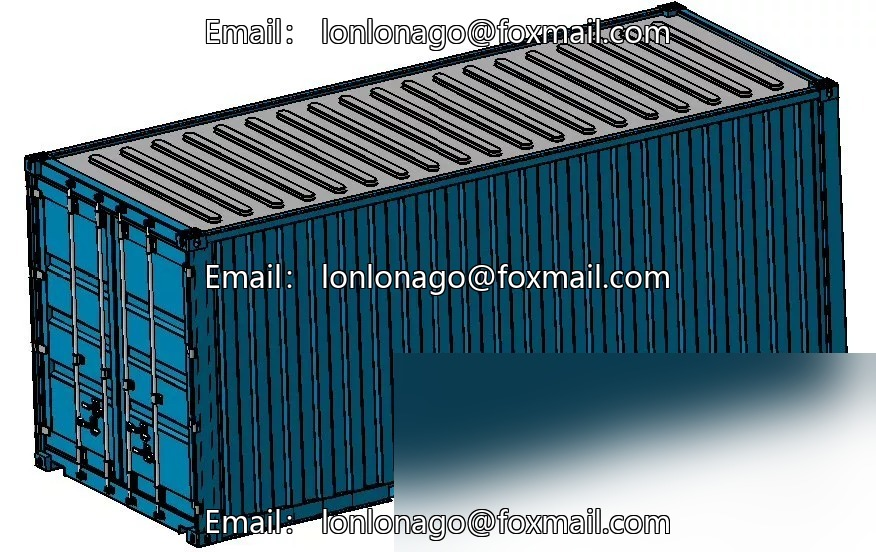
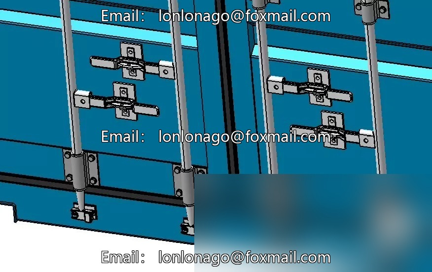
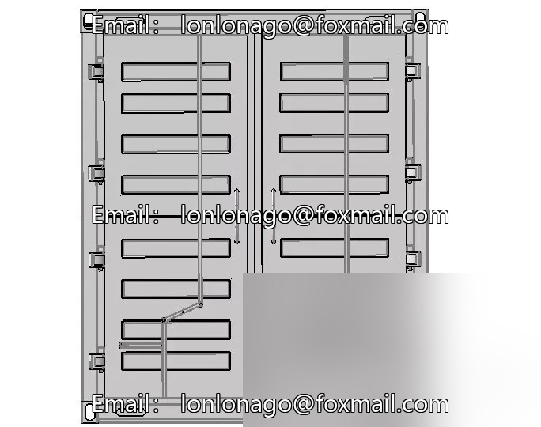

# Container 3D model with multiple sizes

## Body

Container 3D digitized model of multiple sizes container diagram, container three-dimensional model, container digitized model, container 3D, container data model, including multiple container sizes such as 20-meter and 40-meter containers

Multiple models, can be opened and edited with CATIA UG SolidWorks, etc.
A021 There are other various 3D drawings, including modeling and numeric model modification services, details can be discussed in detail.

Provide container 3D models covering multiple sizes, including pictures, 3D images and data models, plus modeling and model-modification services.

<!-- AI_ENRICHED -->

## Images

## Payment

Here is a pay link on Stripe ( https://buy.stripe.com/3cs8yP7sY87d0vu9AB ). Please contact me lonlonago@foxmail.com after funding $89, and I will send you a complete data files , thank you!

